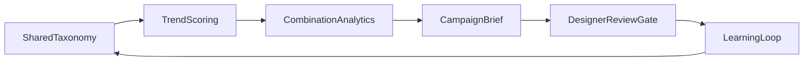

# Design–marketing flywheel

Reference architecture for an agentic loop that sits on top of a structured product-attribute dataset. Trend signals, combination analytics, campaign briefs, and a learning pass share one taxonomy. A designer review gate sits in front of every released brief.

This repository is a public scheme of work. It uses synthetic signals. It does not include client catalogs, campaign data, or brand names.

## Problem

A catalog team already has structured attributes for every style. Design and marketing still research trends and write briefs by hand, and last season’s campaign results do not flow back into the next design cycle. The missing piece is an orchestration layer, not another model.

## Context



| Layer | What it does |
| --- | --- |
| Data | Attribute taxonomy plus external trend phrases and a sell-through prior |
| Intelligence | Score velocity, rank combinations, draft a brief |
| Orchestration | Fixed node order that mirrors a LangGraph `StateGraph` |
| Interface | Gate decision: `approve`, `revise`, or `hold` |

Production shape: LangGraph + LangChain, scheduled when new signals arrive. This repo keeps the same node order in plain Python so the cycle runs without paid APIs.

## Component choices

- **Shared taxonomy as the substrate.** Agents do not invent attributes. They map phrases onto keys that already exist.
- **Draft versus released.** The language model, or this deterministic stand-in, only writes a draft. A person releases it.
- **Learning runs after release.** A held or revised brief does not change next-season priors.

## Tradeoffs

1. **Agent graph versus a fixed pipeline.** A graph earns its keep when routing changes by signal type (catalog versus social, peak versus declining). A fixed pipeline is enough when every cycle is the same four stages. This reference uses a fixed graph so the gate and the learning rule stay obvious. Promote a node to a true agent only when the route itself is a decision.
2. **Why the attribute dataset is the substrate.** Long-context summarization of trend essays will write fluent briefs that do not match catalog values. Mapping onto the taxonomy is stricter and less poetic. That is the point: design and marketing have to act on the same keys the catalog already stores.

## What good means

- Every scored combination uses only keys present in `config/taxonomy.yaml`.
- `released_brief` is empty unless the gate decision is `approve`.
- `learning_update.applied` is true only when a brief was released.
- A cycle is inspectable: `notes` records which node ran and why.

## How to run

```bash
python -m pip install -r requirements.txt
python examples/run_cycle.py
```

Expected: JSON with a released brief for `sage` / `linen` / `wide-leg`, and a learning update with a prior adjustment.

To hold a brief instead of releasing it, change `decision="approve"` to `decision="hold"` in `examples/run_cycle.py`.

## Layout

```
config/taxonomy.yaml     shared attribute keys
src/flywheel/graph.py    node order
src/flywheel/gate.py     human review
src/flywheel/stages/     trend, analytics, brief, learn
examples/run_cycle.py    one scheduled cycle
```
